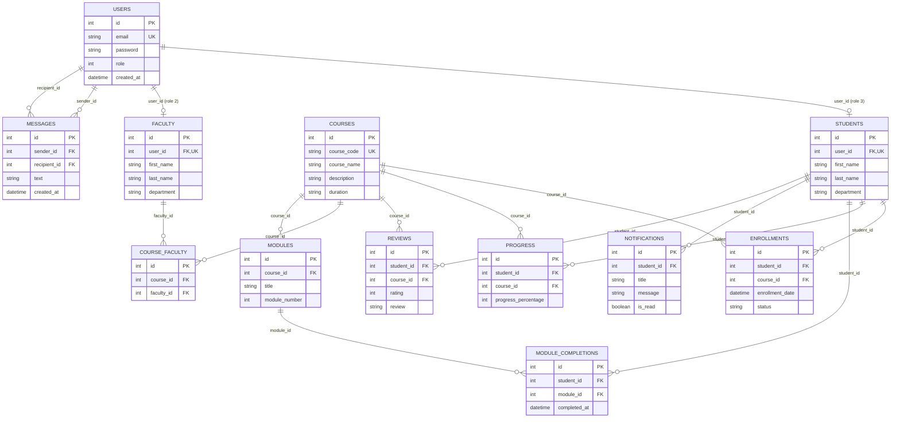

# Database schema

## Database choice

The Express backend defaults to a local JSON document database in `mockapi/db.json`. Each top-level array is a collection; each record is a document with a server-generated integer `id` primary key. Set `DATABASE_PROVIDER=mongodb` and `MONGO_URI` to use the optional MongoDB implementation in hosted environments.

The backend validates field types and required values in `src/services/validationService.js`. `src/services/databaseConstraints.js` enforces unique keys, references, and delete restrictions before a write is persisted. A failed write does not update the data file.

## Collections

| Collection | Fields | Keys and constraints |
|---|---|---|
| `users` | `id`, `email`, `password`, `role`, `created_at` | `id` primary key; `email` required, valid, case-insensitive unique; `password` required and bcrypt-hashed; `role` required (`1` admin, `2` faculty, `3` student). New passwords must contain 12-72 characters and at most 72 UTF-8 bytes. |
| `students` | `id`, `Sid`, `user_id`, `first_name`, `last_name`, `age`, `gender`, `address`, `phone`, `dob`, `department`, `blacklisted` | `id` primary key; `user_id` optional unique reference to a user with role `3`; optional `Sid` unique. First and last names required. |
| `faculty` | `id`, `Fid`, `user_id`, `first_name`, `last_name`, `phone`, `department`, `qualification`, `specialization`, `employee_id`, `blacklisted` | `id` primary key; `user_id` optional unique reference to a user with role `2`; optional `Fid` and `employee_id` unique. First and last names required. |
| `courses` | `id`, `course_name`, `course_code`, `instructor`, `duration`, `credits`, `category`, `description` | `id` primary key; `course_name` and `course_code` required; `course_code` unique; credits must be non-negative when provided. |
| `course_faculty` | `id`, `course_id`, `faculty_id` | `id` primary key; both references required; `(course_id, faculty_id)` unique. |
| `modules` | `id`, `course_id`, `title`, `description`, `module_number`, `video_link`, `notes`, `duration` | `id` primary key; course reference and title required; `(course_id, module_number)` unique when a module number is supplied. |
| `enrollments` | `id`, `student_id`, `course_id`, `status`, `enrollment_date`, `unenrolled_at` | `id` primary key; student and course references required; `(student_id, course_id)` unique. Status is `Enrolled`, `Completed`, or `Unenrolled`; unenrollment preserves the enrollment and learning history. |
| `progress` | `id`, `student_id`, `course_id`, `completed_modules`, `total_modules`, `progress_percentage` | `id` primary key; student and course references required; `(student_id, course_id)` unique; percentage is between 0 and 100. |
| `module_completions` | `id`, `student_id`, `module_id`, `completed_at` | `id` primary key; student and module references required; `(student_id, module_id)` unique. Completion records are created through the authenticated lesson-completion endpoint. |
| `notifications` | `id`, `student_id`, `title`, `message`, `is_read`, `created_at` | `id` primary key; student reference, title, and message required; read flag is boolean; recipient/date index supports recent notification queries. |
| `messages` | `id`, `sender_id`, `recipient_id`, `text`, `created_at` | `id` primary key; both user references and message text required; text is limited to 2,000 characters; sender/recipient/date indexes support private conversation history. |
| `reviews` | `id`, `student_id`, `course_id`, `rating`, `review` | `id` primary key; student and course references, rating, and review required; `(student_id, course_id)` unique; rating is an integer from 1 to 5. |

Reference fields store the referenced document's `id`. Optional profile references allow the existing admin screens to create profiles independently; when supplied, they must reference a user with the matching role. Deleting a referenced record is rejected with `409 Conflict`; remove dependent records first. Seeded demo account passwords are bcrypt-hashed; `demo123` remains the local-only login password. The MongoDB import script hashes any plaintext seed passwords before insertion.

## Entity relationship diagram

`COURSE_FACULTY` represents the many-to-many relationship between faculty and courses. A student can enroll in many courses, and a course can have many enrolled students; `ENROLLMENTS` stores the relationship and its date/status.

## Persistence

Start the API from the `backend` directory. The default database provider is `file`, using `../mockapi/db.json`; set `DATA_FILE` to use another JSON database file. API writes are serialized and saved to the JSON file only after validation succeeds.

Set `DATABASE_PROVIDER=mongodb` and `MONGO_URI` to use MongoDB instead. The backend defines corresponding Mongoose collections and indexes in `src/models/index.js`; run `npm run seed:mongo` from `backend/` to import the JSON demo records, with passwords hashed during import.
